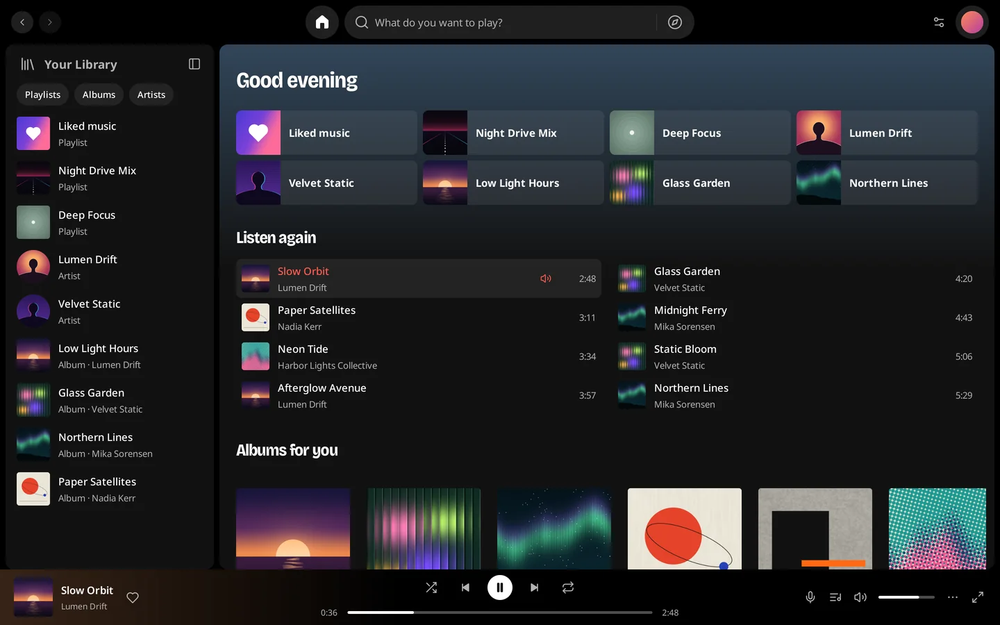
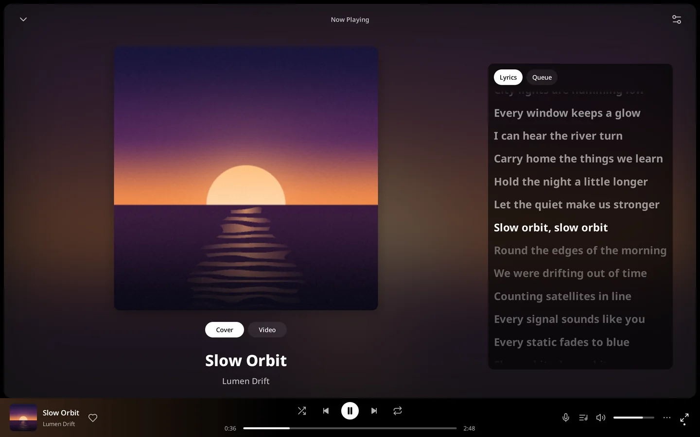
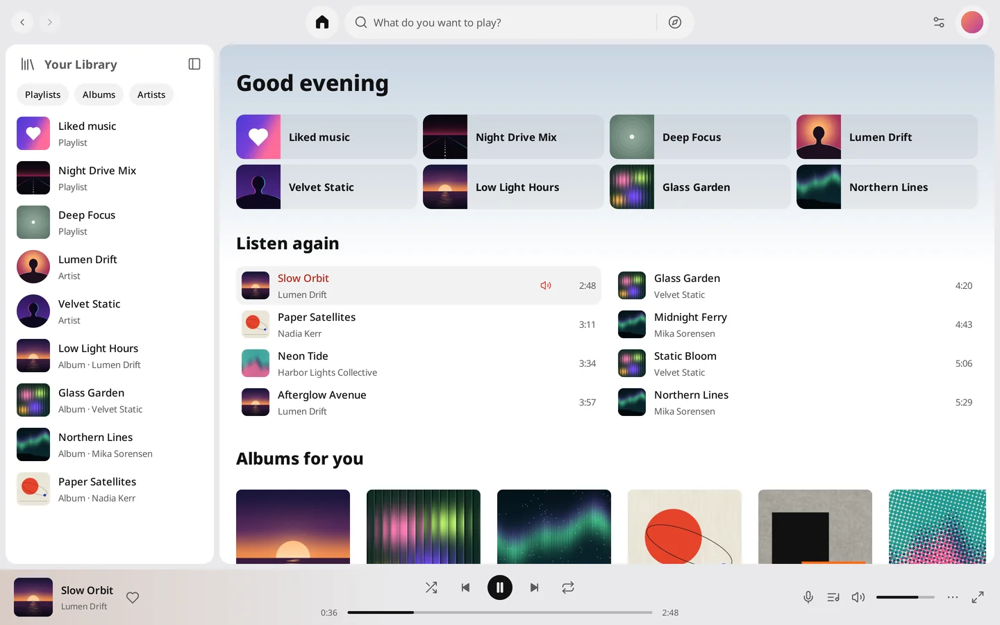

# ytmGO

**English** · [简体中文](README.zh-CN.md) · [Website](https://ytmgo.kyun.si/)

YouTube Music has no official desktop app on macOS, Windows, or Linux. **ytmGO** is a free, open-source desktop client that brings Spotify's desktop design language to the YouTube Music catalogue.

**[Download the latest release](https://github.com/mreasonyang/ytmgo/releases/latest)** · `brew install --cask mreasonyang/taps/ytmgo` · [All releases](https://github.com/mreasonyang/ytmgo/releases)



> ytmGO is an unofficial open-source client under Apache-2.0. It is not affiliated with, endorsed by or sponsored by Google, YouTube, or Spotify. YouTube and YouTube Music are trademarks of Google LLC.

## Highlights

- **Synced lyrics that follow playback:** the active line is auto-centred in coral; drag vertically inside the lyrics to preview any line's timestamp (`<time> · Release to seek`) and jump right to it.
- **One-click Now Playing (`⌘J`) & full-window Immersive Mode (`⇧⌘F`).**
- **On-demand 144p–1080p music video:** switching back to Cover or minimizing releases the video decoder immediately while audio continues uninterrupted.
- **Instant `⌘K` search & 2,600+ track playlists at 60fps.**
- **Live resize from wide desktop down to a mini player**, with Dark/Light themes and English, 简体中文, 繁體中文 and 日本語 switching live without interrupting playback.
- **Native macOS, Windows 11 & Linux apps:** system Now Playing media controls and media keys, system tray, a global play/pause shortcut (`⇧⌘Space` / `Ctrl+Shift+Space`), an AES-256-GCM encrypted session with its key in the OS secret store, and Ed25519-signed in-app updates.
- **Light on memory:** **90.81 MiB** for a restored paused session and **322.11 MiB** median during active playback with synced lyrics, measured across the whole process tree. See [Memory Footprint](#memory-footprint).

---

## Supported Platforms & Installation

| Platform | Architectures | OS / Runtime Requirements | Installation Entry |
| --- | --- | --- | --- |
| **macOS** | Apple Silicon (`arm64`), Intel (`x86_64` / `amd64`) | **macOS 13 Ventura or newer** (no extra runtime dependencies) | `brew install --cask mreasonyang/taps/ytmgo` or signed & notarized `.dmg` / `.zip` from [Latest Release](https://github.com/mreasonyang/ytmgo/releases/latest) |
| **Windows** | x64 (`amd64` / `x86_64`) | Current **Microsoft Edge WebView2 Runtime** (`>= 101.0.1210.39`); installer is per-user and **not Authenticode signed** | Setup `.exe` or portable `.zip` from [Latest Release](https://github.com/mreasonyang/ytmgo/releases/latest) |
| **Linux** | x64 (`amd64` / `x86_64`) | **Ubuntu 24.04 x64** smoke-test baseline (or compatible distro with **GTK 3**, **WebKitGTK 4.1 `>= 2.50.2`**, **`libsecret >= 0.19` + running Secret Service**, and a desktop display/audio session) | `.deb` (`sudo apt install`) or portable `.tar.gz` from [Latest Release](https://github.com/mreasonyang/ytmgo/releases/latest) |

- **Published architectures:** Windows ARM64 and Linux ARM64 packages are not published.
- **Self-contained end-user bundles:** Installed packages include the Rust playback script host, minimal FFmpeg 9.0.2, login helper, and `legal/` notices. End users do **not** need Go, Rust, Python, C compilers, Node.js, or npm.

### macOS (Homebrew & Direct Download)

#### Homebrew (`mreasonyang/homebrew-taps`)

```sh
brew install --cask mreasonyang/taps/ytmgo
```

Requires **macOS 13 Ventura or newer** on **Apple Silicon (`arm64`) or Intel (`amd64`)**. The cask in [`mreasonyang/homebrew-taps`](https://github.com/mreasonyang/homebrew-taps/blob/main/Casks/ytmgo.rb) downloads the notarized ZIP for its listed version, selects your Mac's architecture automatically, verifies the SHA-256 digest, and installs Developer ID signed and Apple-notarized `ytmGO.app` into `/Applications`. To update via Homebrew:

```sh
brew update
brew upgrade --cask --greedy mreasonyang/taps/ytmgo
```

Quit ytmGO before switching between manual and Homebrew installation; if a manually installed copy already exists in `/Applications`, back it up and move it out before the first Homebrew install (do not use `--force` to overwrite it). `brew uninstall --cask ytmgo` keeps your encrypted account session and preferences. See [docs/HOMEBREW.md](docs/HOMEBREW.md).

#### Direct Download (DMG / ZIP)

1. From [Latest Release](https://github.com/mreasonyang/ytmgo/releases/latest), download the signed and notarized package matching your Mac's CPU (requires **macOS 13+**):
   - **Apple Silicon (`arm64`):** `ytmgo-<version>-arm64-notarized.dmg` (or `.zip`)
   - **Intel (`x86_64` / `amd64`):** `ytmgo-<version>-amd64-notarized.dmg` (or `.zip`)
2. Mount the DMG or extract the ZIP, then copy `ytmGO.app` into a writable `/Applications` directory before launching (running directly from a read-only mounted DMG volume or read-only location prevents in-place updates).

### Windows x64 (`amd64`)

From the [latest release](https://github.com/mreasonyang/ytmgo/releases/latest):

- **Per-User Installer (`ytmgo-setup-<version>-amd64.exe`):** Run the installer. It installs per user and is **not Microsoft Authenticode signed** (Windows SmartScreen may prompt on first run).
- **Portable Archive (`ytmgo-<version>-windows-amd64.zip`):** Extract the **complete** archive into a writable directory, and launch `ytmGO.exe` there. Keep `runtime/`, `login/`, `legal/`, and all other packaged resource directories beside `ytmGO.exe`.
- **Runtime Dependency:** A current [Microsoft Edge WebView2 Runtime](https://developer.microsoft.com/en-us/microsoft-edge/webview2/) (`>= 101.0.1210.39`) is required for Google sign-in and anonymous/non-Premium playback proof generation. If it is missing, install the Evergreen Runtime from Microsoft's download page.

### Linux x64 (`amd64`)

From the [latest release](https://github.com/mreasonyang/ytmgo/releases/latest):

- **Debian / Ubuntu DEB (`ytmgo_<version>_amd64.deb`):** Built and smoke-tested on **Ubuntu 24.04 x64**. Install it from the download directory via `apt` so system dependencies are resolved:
  ```sh
  sudo apt install ./ytmgo_*_amd64.deb
  ```
  Launch **ytmGO** from the desktop applications menu or run `/opt/ytmgo/ytmgo`. Because the DEB installs under root-owned `/opt/ytmgo`, update a DEB installation by installing the newer `.deb` with `apt`.
- **Portable Tarball (`ytmgo-<version>-linux-amd64.tar.gz`):** Extract its **complete** contents into a user-writable directory, and run `./ytmgo` from that directory. Keep `runtime/`, `login/`, `legal/`, and all other packaged resource directories alongside `./ytmgo`.
- **Runtime Dependencies:** Requires a working desktop display and audio session, **GTK 3**, **WebKitGTK 4.1 (`>= 2.50.2`)**, and **`libsecret` (`>= 0.19`) with a running Secret Service** daemon. The DEB declares `libwebkit2gtk-4.1-0 (>= 2.50.2)` and `libsecret-1-0 (>= 0.19)`; other distributions must provide compatible shared libraries (the Linux build is not a statically linked universal binary).

### In-App Updates, Signing & Data Retention

- **Automatic & Manual Updates:** When running from a user-writable directory, ytmGO checks for updates automatically (earliest 10 seconds after launch, then once per day) and manually via **ytmGO → Check for Updates…** on macOS or **⋯ → Help → Check for Updates…** in the top bar on Windows and Linux. The [maintenance commands](#common-commands) `--check-for-updates` and `--install-update` do the same from a terminal. The MyGo update window supports **Install Update**, **Later**, **Skip**, and optional automatic downloads, replacing the application in place while retaining your encrypted account session (`account/session.enc`), library snapshot, playback bookmark, and preferences. Update system-owned Linux DEB installations by installing the newer `.deb` with `apt`.
- **Update Signatures vs. OS Code Signing:** Each published target (`darwin-arm64`, `darwin-amd64`, `windows-amd64`, `linux-amd64`) provides an `update-<platform>.json` manifest carrying the `.tar.gz` update archive URL and its **Ed25519 signature**, verified against the embedded public key in `mygo.json` before applying an update. On macOS, the app bundle and DMG are also **Developer ID signed, notarized, and stapled**; on Windows, Ed25519 update-archive signing verifies updater payloads only and does **not** mean the installer or `.exe` is Microsoft Authenticode signed.
- **Release & Packaging Guides:** See [Windows and Linux release details](docs/DESKTOP_RELEASES.md), [Homebrew maintenance](docs/HOMEBREW.md), and [macOS Actions Guide](docs/MACOS_ACTIONS.md).

---

## Everyday Usage

### Browsing & Library

- **Direct Catalogue Access:** Browse **Home**, **Explore**, **Search** (`⌘K` / `Ctrl+K`), **Library** (`⌘L` / `Ctrl+L`), and **Album / Playlist / Artist** pages directly from YouTube Music.
- **Navigation & Pagination:** Scroll near the end of a page to load continuations automatically. **Back / Forward** history preserves the loaded page data for each visited view. Diagonal trackpad/wheel gestures over horizontal song or album shelves route cleanly to the dominant scroll axis.
- **Account-Scoped Library Snapshot:** After your signed-in library loads (including paginated continuations), ytmGO saves a local metadata snapshot (`account/library-snapshot.json`) bound to the current encrypted session. On restart, your saved library appears immediately while refreshing in the background; if an update fails, the saved list remains visible with an explicit **Retry** button. Unverified private entries stay disabled while signed out or offline, and signing out or switching accounts clears the snapshot.

### Playback & Restart Restoration

- **Transport Controls:** Click any song or collection play button to start listening. Controls include Play/Pause (`Space` inside the app, or `⌘P` / `Ctrl+P`), Previous/Next (`⌘←` / `⌘→` or `Ctrl+Left` / `Ctrl+Right`), seek bar with hover/drag time readout, volume (`⌘↑` / `⌘↓` or `Ctrl+Up` / `Ctrl+Down`), mute (`⇧⌘M` / `Ctrl+Shift+M`, preserving your previous unmuted volume), shuffle, repeat (**Off**, **All**, **One**), Like/Unlike, and right-click context menus (**Play**, **Add to queue**).
- **Restart Session Restore:** On normal quit (`⌘Q` / `Ctrl+Q`), ytmGO saves your current queue, selected track index, playback position bookmark, volume, and unmuted volume (`playback-session.json`). On the next launch, it restores the queue, track, volume/mute state, and exact position in a **paused** state (publishing paused system Now Playing metadata) until you explicitly press **Play**. Reconnecting a saved account after an offline launch retains the restored paused bookmark; explicit new sign-in or sign-out clears the old queue.
- **Next-Track Prefetch:** No script host or proof engine is warmed at startup. While a track plays, Go prepares at most the next queued track's stream and initial PCM so natural transitions start without re-resolving; random selection, cold start, seeks, queue changes, and account switches cancel obsolete preparation.

### Now Playing, Synchronized Lyrics & Video



- **Now Playing Views:** Click the artwork/title in the bottom player bar (or press `⌘J` / `Ctrl+J`, or click the **Lyrics** / **Queue** buttons) to open the **Now Playing** panel, or toggle full-window **Immersive Mode** (`⇧⌘F` / `Ctrl+Shift+F`).
- **Default Lyrics on First Play:** When playback starts for the first time in a session, Now Playing opens automatically on the **Lyrics** tab—unless you have already opened or dismissed Now Playing or Immersive Mode during that session.
- **Live Follow & Manual Reading:** When synchronized lyrics are available, the current cue is highlighted and kept centered inside the lyrics viewport without moving the outer panel. Scrolling with a mouse wheel, trackpad, keyboard, or scrollbar switches to manual reading and reveals a **Follow playback** button below the lyrics viewport; clicking it (or pressing `Tab` then `Return`) returns to live following. Tracks without synchronized timing display plain lyrics or an unavailable notice.
- **Drag Lyrics to Seek:** On tracks with synchronized lyrics, drag vertically inside the lyrics area to preview target cues (highlighting the selected line against a center guide with a `<time> · Release to seek` badge). Releasing the pointer seeks to that cue's start timestamp and resumes live following while preserving play or pause state. Single clicks, horizontal movement, pressing `Escape`, or losing focus cancels the gesture without seeking.
- **Expandable Lyrics Layout:** On the **Lyrics** tab (outside Immersive Mode and Video mode), click the expand button beside the **Lyrics / Queue** chips to shrink the cover art and give more vertical height to lyrics. Click again to restore the cover size; this choice is saved in `lyrics-layout` across restarts.
- **On-Demand Video:** Switch between **Cover** and **Video** in Now Playing or Immersive Mode. Video is decoded on demand by a dedicated FFmpeg decoder (**720p by default**, with **144p–1080p** selectable beside the Video switch or in Settings; rendered at 24fps, synchronized to the audio clock, preserving aspect ratio). Your last choice is saved immediately and retained across track changes and app restarts; changing it restarts only video at the current audio position. If the selected resolution is unavailable, a lower source resolution is used when available. Hiding or minimizing the window, closing Now Playing/Immersive Mode, or switching back to **Cover** immediately releases the video decoder while audio continues uninterrupted.

### Responsive Layout, Localization & Shortcuts



- **Adaptive Window Geometry:**
  - **Wide (`>1180` DIP):** Full collapsible library sidebar (`⌘B` / `Ctrl+B`), main page panel, and docked right-hand Now Playing panel.
  - **Medium (`761–1180` DIP):** Compact 72-DIP icon rail and floating Now Playing dialog.
  - **Compact (`≤760` DIP):** Single-column page, floating mini player card, and bottom navigation tab bar.
- **Languages & Themes:** Settings (`Settings → General`) supports **English**, **简体中文**, **繁體中文**, **日本語** (plus **Match system**), and **Dark**, **Light**, or **System** appearance. Changes redraw the application window immediately without interrupting playback.
- **System Integration & Shortcuts:** Application menus (the menu bar on macOS; on Windows and Linux, the **⋯** button that leads the top bar, also opened with `Alt` or `F10`), system tray, OS Now Playing media controls, and a configurable global play/pause shortcut (`⇧⌘Space` / `Ctrl+Shift+Space` by default, recordable or disableable in `Settings → Keyboard`) share the same playback controller. Press `⌘/` (`Ctrl+/`) or open `Settings → Keyboard → View all` to inspect all in-app shortcuts.

---

## Account Sign-In, Security & Platform Limits

### Isolated System WebView Sign-In

- Clicking **Sign in** launches a separate, temporary Wry system WebView helper process (`WKWebView` on macOS, `WebView2` on Windows, `WebKitGTK` on Linux) showing Google's official sign-in page.
- The login helper uses a distinct **ytmGO** icon with a teal account badge and keeps its own Dock / taskbar / window-switcher entry so multi-step verification is easy to return to; clicking the main app or Dock icon while sign-in is active focuses the existing login window.
- Normal interactive sign-in has no forced application timeout. Once sign-in completes, the helper reads the selected account's cookies from the private WebView store, hands them to the main process over an anonymous parent-child pipe, and exits. The main UI and audio playback never depend on the login window.
- There is no browser extension, local HTTP login bridge, OAuth client configuration, or temporary cookie file. Closing the login window cancels sign-in and keeps any previously connected account. External links open in your system default browser.

### Passkey & Platform Authentication Limits

- **macOS (`WKWebView`):** Google passkey sign-in is **not supported** in the macOS login window. Apple requires `WKWebView` passkey relying parties to have an Associated Domains relationship with the application (or a restricted web-browser entitlement), which an independent client cannot obtain for `google.com`. Use another verification method offered by Google's sign-in page; accounts that only allow passkeys cannot currently complete sign-in on macOS. See [Apple Passkeys Documentation](https://developer.apple.com/documentation/authenticationservices/supporting-passkeys).
- **Windows (`WebView2`):** Requires Microsoft Edge WebView2 Runtime (`>= 101.0.1210.39`). While WebView2 supports FIDO2, ytmGO has not yet been live-tested against specific Google passkey providers on Windows.
- **Linux (`WebKitGTK`):** Requires WebKitGTK 4.1 `>= 2.50.2` and `libsecret` (`Secret Service`). Version `2.50.2` avoids an upstream WebKitGTK hang on Google accounts with WebAuthn second factors, though this does not establish Linux passkey support. See [WebKitGTK 2.50.2 Release Notes](https://webkitgtk.org/2025/11/19/webkitgtk2.50.2-released.html).

### Single-Key Encrypted Session Storage

- Your full session (cookies and selected account metadata) is encrypted with **AES-256-GCM** (`YTMSESS\x03` authenticated header, fresh 12-byte random nonce, ciphertext, and 16-byte tag) in `account/session.enc` under the app data directory (`0700` directory and `0600` file on macOS/Linux; per-user AppData on Windows).
- The OS secret store (macOS Keychain, Windows Credential Manager, Linux Secret Service) holds only a single 32-byte random encryption key under the fixed entry name `account-session-key`.
- Before opening the login window, ytmGO prepares this key in memory: reusing a restored key, reading `account-session-key`, or creating it only when explicitly not found. If secret-store access is denied, locked, or malformed, sign-in fails immediately before opening the login window without overwriting existing data.
- After login and YouTube membership verification succeed, ytmGO encrypts and atomically replaces `account/session.enc` using the prepared in-memory key, without making another OS secret-store call. Only this single encrypted format is read or written; there is no legacy migration or plaintext fallback.
- On macOS startup, automatic restoration reads Keychain silently without triggering a system authorization dialog (`NoPrompt`). If restoration takes longer than 12 seconds or is deferred, the UI offers **Continue without account** and **Restore account** so you can listen to public tracks anonymously while keeping your saved session intact.
- Confirming **Sign out and clear local data** stops playback, deletes `account/session.enc` first, and then deletes `account-session-key` from the OS secret store (allowing retry if key deletion fails, even after the file is gone). Signing out of ytmGO never affects your Google session in external browsers.

### Membership Polling & Service Redirects

- Account status is determined strictly from server-returned `logged_in` and `has_unlimited_entitlement` booleans on startup restoration, sign-in, window focus, and every 5 minutes. Network errors or missing fields are treated as transient errors, never as membership expiration.
- **Premium mode** never loads DOM or proof modules; **standard (non-Premium) and signed-out modes** launch the proof engine on demand when playback requires it. Same-account membership changes reap obsolete proof engines while keeping the currently playing stream; account identity changes or sign-out revoke old streams.
- When Google or YouTube returns a verification, consent, sign-in, or unknown redirect page, ytmGO explains the requirement inline and keeps ordinary **Retry** actions for catalogue and playback requests. It does not offer unverified web-verification flows, mislabel ordinary HTTP `403`/`429`/network errors as CAPTCHAs, or save/open server redirect URLs.

---

## Runtime Architecture, Network & Privacy Boundaries

**ytmGO** is a cross-platform YouTube Music desktop client built with Go and **MyGo 0.7.1**. The user-facing brand is **ytmGO**, while the repository, release artifact prefix, bundle identifier (`si.kyun.ytmgo`), helper identifiers, and local data directories retain the technical name `ytmgo`.

The main music window uses a custom-rendered Go/MyGo interface (`ui.View`), with controls drawn by the toolkit rather than each operating system's standard widget library. Separate system WebViews handle Google sign-in and on-demand anonymous/non-Premium playback verification. Go handles YouTube Music catalogue requests, session verification, format selection, and bounded media streaming; MyGo outputs decoded audio to the system audio device, and an on-demand FFmpeg decoder renders video only while a video view is visible.

- **Node-Free Playback Runtime:** `make build` packages the Go main executable alongside a small Rust script host (`ytmgo-playback-host`) and a minimal **FFmpeg 9.0.2** binary. Dynamic player script extraction uses pinned MIT **YouTube.js** extractor subsets and ISC **Meriyah** in a temporary **QuickJS** process that exits immediately after returning bounded transform code; signature evaluations run in a fresh QuickJS realm per call (32 MiB limit, 3-second interrupt). Anonymous/free proof generation runs MIT **BgUtils** inside an isolated, hidden, non-persistent Wry system WebView with network/media blocked by CSP. No Node binary, npm tree, jsdom, or full YouTube.js SDK is shipped. Details: [scripts/runtime/README.md](scripts/runtime/README.md).
- **Bounded Media Streaming:** Remote media URLs and account credentials stay in Go memory. FFmpeg connects only to a per-decoder random loopback capability URL passed over `stdin`. Go fetches remote media in **64 KiB** audio ranges and **512 KiB** video ranges, forwarding with **32 KiB** backpressure across at most 4 active leases/requests and without caching full tracks on disk.
- **Proxy & Artwork Policy:** Catalogue, account verification, artwork, and media requests share `internal/netproxy`. Explicit `HTTP_PROXY`, `HTTPS_PROXY`, and `NO_PROXY` environment variables take priority on all platforms; on macOS, normal launches also read system HTTP, HTTPS, and SOCKS proxy settings and bypass rules. Local decoder loopback traffic always connects directly. PAC scripts and proxy passwords are not supported. Visible artwork is prioritized and retries with exponential backoff (2s to 1m). Thumbnails, browsing covers and player covers share a retained bitmap budget of **80 MiB** across three independently capped pools. Public cover responses follow HTTP freshness and conditional validation. The disk cache allows **64 MiB / 512 distinct cover URLs** and preserves **256 MiB** of free volume space before admitting a write. Account avatars bypass disk storage.
- **Sanitized Diagnostics:** Local files under `native-diagnostics/` (`audio-status.json`, `video-status.json`, `account-status.json`) record only fixed status/failure categories, timestamps, and app version (plus closed-set stage, bootstrap step, HTTP status code, redirect category, and MIME type on playback init failures). Media URLs, headers, cookies, account identifiers, process arguments/environments, and raw logs are never written.

---

## Verification Scope & Current Caveats

Detailed design specifications live in [DESIGN.md](DESIGN.md); historical and local verification records live in [VERIFICATION.md](VERIFICATION.md) and [docs/AUTO_UPDATE_VERIFICATION.md](docs/AUTO_UPDATE_VERIFICATION.md). Current boundaries to keep in mind:

- **v0.0.64 UI Upgrade Acceptance (2026-11-06):** The actual installed macOS ARM app detected the public 0.0.64 release from 0.0.61, downloaded and installed it through its native update UI, relaunched automatically, and then reported it was up to date. The updated bundle matches the public ZIP; login, paused position, volume and preferences were preserved. See the [verification record](docs/audits/2026-11-06-release-0.0.64/README.md).
- **v0.0.61 Release Acceptance (2026-11-06):** Version numbering restarts at 0.0.61. All 22 public assets, four update signatures, native Windows/Linux installation/startup, macOS signing/notarization and ARM/Intel Homebrew installs passed verification. The local ARM installation matches the public ZIP. See the [release verification record](docs/audits/2026-11-06-release-0.0.61/README.md).
- **Earlier 0.6.x Acceptance:** Summaries for releases published before the version reset are kept in [VERIFICATION.md](VERIFICATION.md#06x-release-acceptance-summaries).
- **Platform Acceptance:** On 2026-11-04, both 3-platform GitHub Actions suites—[Native playback runtime](https://github.com/mreasonyang/ytmgo/actions/runs/41800458515) and [Native account login](https://github.com/mreasonyang/ytmgo/actions/runs/41800458464)—passed across macOS, Windows, and Linux. For **v0.6.4** ([audit record](docs/audits/2026-11-04-macos-compat-0.6.4/README.md)), native packaging, Developer ID signing/notarization/stapling, Gatekeeper checks, helper execution, empty-profile startup, and [actual Homebrew cask installs](https://github.com/mreasonyang/homebrew-taps/actions/runs/41850617166) passed on both **macOS 27 Apple Silicon (`arm64`)** and **macOS 15 Intel (`amd64`)**, alongside an [Intel synthetic WebView login lifecycle run](https://github.com/mreasonyang/ytmgo/actions/runs/41848250319), a [public 0.6.3 → 0.6.4 ARM upgrade](https://github.com/mreasonyang/ytmgo/actions/runs/41850200341), and the [Windows/Linux native package workflow](https://github.com/mreasonyang/ytmgo/actions/runs/41849890402) (which builds on the target OS, installs the NSIS/DEB package, and verifies installed resources and empty-profile startup). However, **CI and native package install/startup smoke tests are not live signed-in playback, complete UI interaction, hardware audio output, or version-to-version upgrade acceptance on Windows, Linux, or Intel macOS**; likewise, verifying a **macOS 13.0 deployment target** across all shipped Mach-O binaries is **not** physical runtime acceptance on macOS 13 or macOS 14.
- **Account Tiers & Advertising:** Anonymous full-track playback and real **YouTube Music Premium** browsing, library restoration, and playback have been verified on macOS. **Standard (free/non-Premium) accounts** and **official advertising flows** are **not** accepted: ytmGO does not implement official ad asset sequencing or ad progress reporting, does not simulate ads with artificial wait timers, and does not treat public track playback as ad-flow validation.
- **Memory Footprint:** See [Memory Footprint](#memory-footprint) below for the measured v0.0.64 process-tree figures.
- **Global Shortcuts & Long-Run Stability:** In-app shortcuts (`Space`, `⌘K`, etc.) and UI Tester state machines pass, but physical global shortcut key injection (`⇧⌘Space`) has not yet been confirmed end-to-end on macOS. Local E2E runs also recorded isolated transient playback errors (`audio_stream_failed`, `bootstrap_network_timeout`) that recovered via **Retry** whose upstream/network root causes remain open. Crash/force-kill persistence, sleep/wake endurance, and multi-day stability are not yet certified.

### Memory Footprint

Measured on Apple Silicon (Mac16,8) with [`scripts/diagnostics/measure.py`](scripts/diagnostics/measure.py), which traverses the root PID, all child PIDs (`proc_listchildpids`) and all macOS responsibility-owned helpers (`responsibility_get_pid_responsible_for_pid`), and sums kernel `proc_pid_rusage` `ri_phys_footprint` across `coverage_complete: true` samples:

| ytmGO state | Processes | Memory |
| --- | --- | --- |
| v0.0.64, restored paused session | 2 (main app + `SetStoreUpdateService.xpc`) | **90.81 MiB** median / 90.81 MiB peak |
| Active playback + synced lyrics & UI navigation (432 complete samples) | 4–6 (ytmGO, bounded FFmpeg & Rust/QuickJS host) | **322.11 MiB** median (157.07 MiB min – 353.88 MiB max) |

To compare against a browser or another music app on your own machine, run the same collector against its root process:

```sh
python3 scripts/diagnostics/measure.py --pid <ROOT_PID> --seconds 180 --out /tmp/bench
python3 scripts/diagnostics/summarize.py /tmp/bench/samples.jsonl
```

Details are recorded in [VERIFICATION.md](VERIFICATION.md#ytmgo-v0062-process-tree-memory).

---

## Building & Development

### Build-Time Prerequisites vs. End-User Runtime Dependencies

- **Compiling from source (all platforms):** Go **1.27.3+**, Rust/Cargo, Python 3, and a C compiler toolchain.
- **macOS build host:** Xcode Command Line Tools (`darwin/arm64` and `darwin/amd64` builds target **macOS 13.0+** via `MACOSX_DEPLOYMENT_TARGET=13.0`).
- **Windows x64 build host:** MSYS2 UCRT64 (`gcc`, `make`, `diffutils`) for compiling minimal FFmpeg, plus Microsoft Edge WebView2 Runtime when running the built app.
- **Linux x64 build host:** `build-essential`, `pkg-config`, `nasm`, `libgtk-3-dev`, `libwebkit2gtk-4.1-dev` (`>= 2.50.2`), `libsoup-3.0-dev`, and `libsecret-1-dev` (plus `xvfb`, `xauth`, and `dbus-x11` for headless runtime tests).
- **End-user runtime only:** Installed prebuilt releases do **not** require Go, Rust, Python, C compilers, MSYS2, `-dev` headers, Node.js, or npm—only the target OS runtime requirements listed under [Supported Platforms & Installation](#supported-platforms--installation).

### Common Commands

```sh
# Run Go tests, runtime/login/license checks, go vet, and 4-language i18n check
make check

# Build the packaged application and installer for the current host into build/<os>-<arch>/
make build

# Build the application bundle (skipping macOS DMG) and compile cmd/update-package
make build-app

# Run in development mode (prepares build/runtime and build/login first)
make dev
```

`make build` and `make build-app` produce development packages: updates are disabled in the binary, and About/Settings show `DEV`, the source branch and commit (plus `dirty` for local edits). `mygo.json` tracks the next development target: after public release `0.0.64`, development builds identify as `0.0.65 DEV`. Advance this target after each successful release. `--build-info` exposes structured build identity. Packaged development builds retain the existing account and preferences storage. Release builds explicitly set `RELEASE_VERSION`, run `scripts/release/publish.py configure`, then use `make build-app BUILD_TYPE=release`; CI handles these steps. The release update source is in `scripts/release/update-source.json`.

For a CI development package, open **Actions → Development macOS package → Run workflow**, keep the workflow branch on **main**, and enter the source branch and architecture, or run:

```sh
gh workflow run dev-package.yml --repo mreasonyang/ytmgo --ref main -f source_branch=app-guidebook-redesign -f architecture=arm64
```

Use `architecture=amd64` for Intel or `architecture=all` for both. Download the `ytmgo-dev-macos-<arch>-<run>` artifact containing the ZIP, source receipt and checksums. These builds use the same Developer ID signing identity as stable packages, without notarization. Native builders and verification jobs receive no signing secrets; only the existing main-only `macos-release` environment signs the bundles. Final verification rejects ad-hoc or wrong-team signatures and checks both update commands remain disabled. The workflow never publishes a GitHub Release or changes stable update feeds. Packaged dev and stable apps still share account storage and cannot run as independent applications.

`make build` stages `build/runtime`, `build/login`, and `build/legal` for the current host OS/architecture and outputs to `build/<os>-<arch>/` using the version in `mygo.json`:

- **macOS (`darwin/<arch>`):** Produces `build/darwin-<arch>/ytmGO.app` and `build/darwin-<arch>/ytmgo-<version>-<arch>.dmg` with ad-hoc app signing (`-`) and an unsigned DMG. For example, on Apple Silicon (`darwin/arm64`) at development target `0.0.65`, it writes `build/darwin-arm64/ytmGO.app` and `build/darwin-arm64/ytmgo-0.0.65-arm64.dmg` (launch on macOS with `open build/darwin-arm64/ytmGO.app`). When a local rebuild changes the ad-hoc signing identity on macOS, Keychain may prompt to re-authorize access to `account-session-key`.
- **Linux (`linux/amd64`):** Outputs `build/linux-amd64/ytmgo` and `build/linux-amd64/ytmgo_<version>_amd64.deb` (launch directly on Linux with `./build/linux-amd64/ytmgo`).
- **Windows (`windows/amd64`):** Outputs `build/windows-amd64/ytmGO.exe` and `build/windows-amd64/ytmgo-setup-<version>-amd64.exe` (launch on Windows with `.\build\windows-amd64\ytmGO.exe`).

For GitHub Actions Developer ID signing, Apple notarization, native Windows/Linux packaging, and signed update feed publishing, see [macOS Actions Guide](docs/MACOS_ACTIONS.md) and [Windows and Linux releases](docs/DESKTOP_RELEASES.md).

Packaged executables on all platforms also support non-interactive maintenance flags that exit before starting the music window or accessing account storage (shown below for macOS; use `/opt/ytmgo/ytmgo` or `./ytmgo` on Linux, and `ytmGO.exe` on Windows):

```sh
/Applications/ytmGO.app/Contents/MacOS/ytmGO --version
/Applications/ytmGO.app/Contents/MacOS/ytmGO --build-info
/Applications/ytmGO.app/Contents/MacOS/ytmGO --check-for-updates
/Applications/ytmGO.app/Contents/MacOS/ytmGO --install-update
```

### Repository Layout & Targeted Tests

```text
main.go / controller.go         Window lifecycle, menus, navigation, queue & request generations
updates.go                      MyGo updater plugin setup, menu item & CLI maintenance flags
native_views.go / native_style.go  Custom-rendered MyGo views, responsive layouts, palette & vector icons
native_settings.go              Settings & Keyboard Shortcuts sheets
native_lyrics.go / native_lyrics_drag.go  Synced lyrics follow, manual reading & drag-to-seek
lyrics_layout.go                Persistent standard/expanded lyrics layout preference
playback_session.go             Normal-quit playback bookmark & queue persistence
library_snapshot.go             Account-scoped library snapshot display & background sync
global_shortcut.go              Global play/pause shortcut recorder & OS registration
account.go                      Login helper handoff, 5-minute entitlement polling & sign-out
artwork.go                      Prioritized viewport cover loader, backoff retry & disk cache
video_controller.go             On-demand video lifecycle & 24fps frame updates
diagnostics.go                  Allowlisted audio/video/account diagnostic status files
internal/accountsession/        AES-256-GCM session file & single-key OS secret store
internal/accountlogin/          Parent-child pipe protocol & login helper process management
internal/catalog/               Typed Innertube client, browse/search/continuation, queue & lyrics
internal/librarysnapshot/       Sanitized library snapshot serialization
internal/netproxy/              Environment & macOS system proxy selection
internal/player/ / internal/streaming/   Bootstrap, QuickJS/WebView proof host, range relay & FFmpeg PCM/video
native/account-login/           Cross-platform Wry temporary Google sign-in helper (Rust)
native/playback-host/           QuickJS extractor/evaluator & non-persistent proof WebView (Rust)
locales/                        English, Simplified Chinese, Traditional Chinese & Japanese catalogs
scripts/runtime/                Locked playback runtime & minimal FFmpeg 9.0.2 builder
scripts/login/                  Login helper builder & platform binary verifier
scripts/licensing/              Bundled legal notices & LGPL/MPL corresponding source collector
scripts/release/                macOS signing, notarization, release publication & update checks
scripts/diagnostics/            Safe process-tree physical-footprint collector (no argv/env reads)
```

```sh
# Race detector across all Go packages
go test -race ./...

# Player unit tests with the prepared runtime
YTMGO_RUNTIME_DIR="$PWD/build/runtime" go test ./internal/player

# Opt-in live catalogue & playback checks
YTMGO_LIVE_CATALOG=1 go test -v -run TestLive ./internal/catalog
YTMGO_RUNTIME_DIR="$PWD/build/runtime" YTMGO_LIVE_PLAYBACK=1 go test -v -run TestNativePlaybackLive ./internal/player
YTMGO_RUNTIME_DIR="$PWD/build/runtime" YTMGO_LIVE_PREPARED=1 go test -v -run TestNativePreparedPlaybackLive ./internal/player

# Deterministic MyGo software-renderer UI snapshots
YTMGO_UI_SNAPSHOT_DIR="$PWD/build/native-screenshots" go test -run '^TestNative' .
```

Software-renderer layout snapshots test custom-rendered MyGo view geometry deterministically; real-app interaction, audio device output, live network behavior, and whole-app memory measurements are verified and recorded separately.

---

## License

Original **ytmgo** code, documentation, and project assets are licensed under the [Apache License 2.0](LICENSE); see [NOTICE](NOTICE) for copyright and attribution and [CONTRIBUTING.md](CONTRIBUTING.md) for contribution terms.

Third-party dependencies, adapted code, and generated bundles containing third-party code retain their upstream licenses and copyright notices—including **FFmpeg 9.0.2** under **LGPL-2.1-or-later** and **MPL-2.0** components (such as `option-ext` when selected by the target's Rust dependency graph); see [THIRD_PARTY_NOTICES.md](THIRD_PARTY_NOTICES.md).

During `make build` and `make build-app` (and verifiable via `make check-licenses`), the build system generates a target-specific `legal/` directory inside the packaged application containing upstream notices, `manifest.json`, and checksum-verified corresponding source archives plus rebuild instructions for FFmpeg and MPL-2.0 components.
