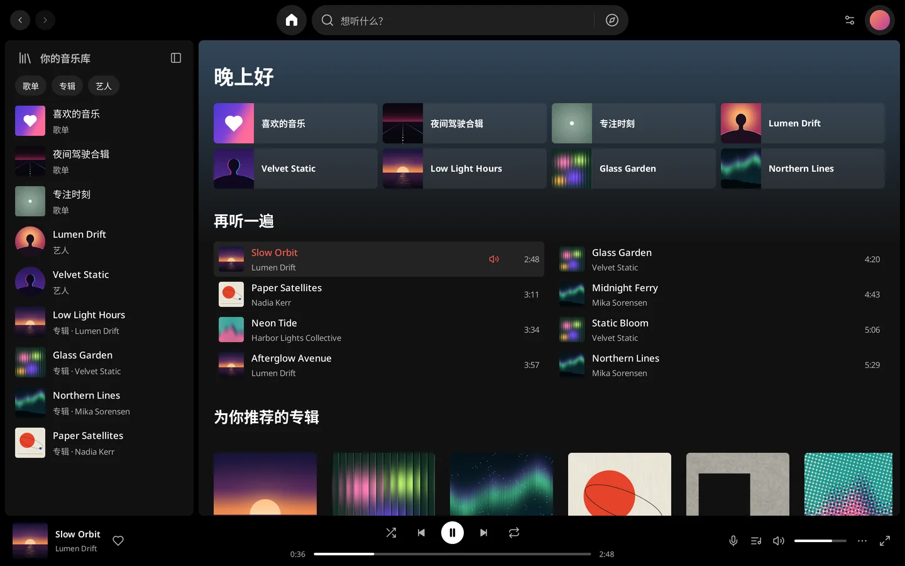
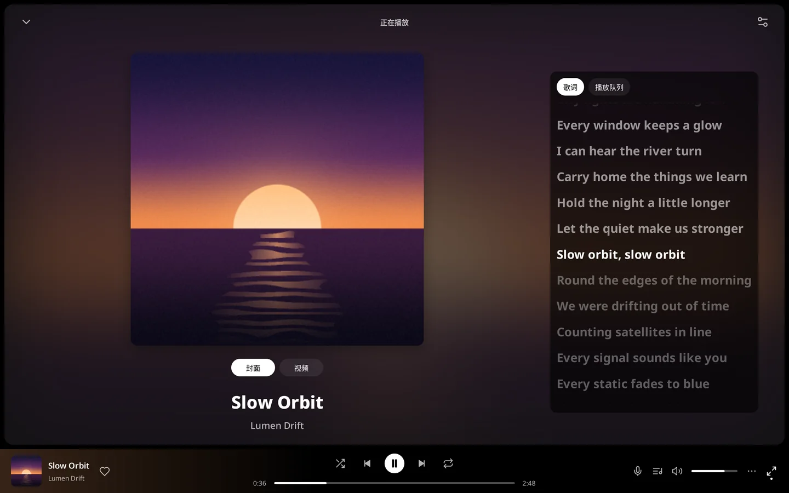
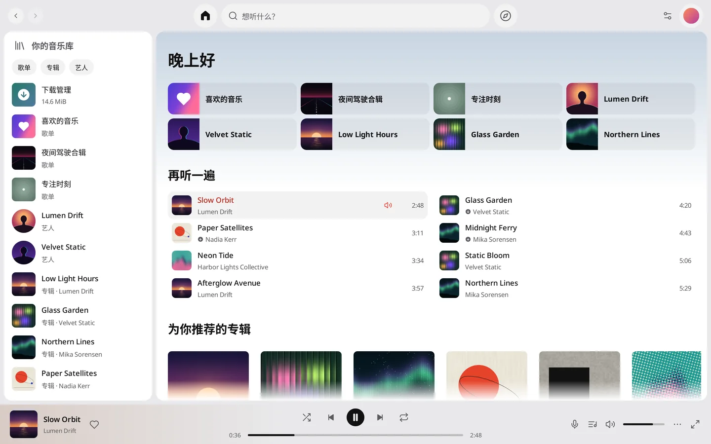

# ytmGO

[English](README.md) · **简体中文** · [官网](https://ytmgo.kyun.si/)

YouTube Music 在 macOS、Windows 和 Linux 上一直没有官方桌面端。**ytmGO** 是一款免费开源的桌面客户端，将 Spotify 桌面端的交互与设计语言带到 YouTube Music 曲库。

**[下载最新版本](https://github.com/mreasonyang/ytmgo/releases/latest)** · `brew install --cask mreasonyang/taps/ytmgo` · [全部版本](https://github.com/mreasonyang/ytmgo/releases)



> ytmGO 是 Apache-2.0 开源的非官方客户端，与 Google、YouTube 及 Spotify 无关，也未获其认可或赞助。YouTube 和 YouTube Music 是 Google LLC 的商标。

## 亮点

- **实时居中同步歌词：** 当前歌词以珊瑚红居中高亮；在歌词区域上下拖拽可预览任意一句的时间（`<时间> · 松开跳转`），松开即精准跳转。
- **一键展开「正在播放」（`⌘J`）与全窗口沉浸模式（`⇧⌘F`）。**
- **按需切换 144p–1080p 官方 MV 视频：** 切回封面或最小化窗口会立即释放视频解码器，音频零中断。
- **`⌘K` 毫秒级搜索，2,600+ 首超长歌单 60fps 丝滑滚动。**
- **窗口宽度从桌面三栏平滑自适应至迷你悬浮播放器**，深浅色主题与 English、简体中文、繁體中文、日本語 四种界面语言实时切换，音乐不中断。
- **原生支持 macOS、Windows 11 与 Linux：** 系统媒体中心与媒体键、系统托盘、全局播放/暂停快捷键（`⇧⌘Space` / `Ctrl+Shift+Space`）、AES-256-GCM 加密会话（密钥存于系统密钥库），以及 Ed25519 签名的应用内更新。
- **内存占用低：** 恢复会话并暂停时仅 **90.81 MiB**，连续播放 + 同步歌词时中位数 **322.11 MiB**，均为包含所有辅助进程的整个进程树实测。详见[内存占用](#内存占用)。

---

## 支持平台与快速安装概览

| 平台 | 支持架构 | 系统与运行环境要求 | 安装方式 |
| --- | --- | --- | --- |
| **macOS** | Apple Silicon（`arm64`）、Intel（`x86_64` / `amd64`） | **macOS 13 Ventura 及以上**（无需安装额外运行时依赖） | `brew install --cask mreasonyang/taps/ytmgo`，或从 [Latest Release](https://github.com/mreasonyang/ytmgo/releases/latest) 下载已签名并公证的 `.dmg` / `.zip` |
| **Windows** | x64（`amd64` / `x86_64`） | 需要当前版本的 **Microsoft Edge WebView2 Runtime**（`>= 101.0.1210.39`）；单用户安装器**尚未进行 Authenticode 签名** | 从 [Latest Release](https://github.com/mreasonyang/ytmgo/releases/latest) 下载安装器 `.exe` 或便携 `.zip` |
| **Linux** | x64（`amd64` / `x86_64`） | 以 **Ubuntu 24.04 x64** 为原生构建与冒烟测试基线；兼容发行版需具备桌面显示与音频会话、**GTK 3**、**WebKitGTK 4.1 `>= 2.50.2`**，以及 **`libsecret >= 0.19` 与运行中的 Secret Service** | 从 [Latest Release](https://github.com/mreasonyang/ytmgo/releases/latest) 下载 `.deb`（`sudo apt install`）或便携 `.tar.gz` |

- **已发布架构：** 暂不发布 Windows ARM64 与 Linux ARM64 预编译包。
- **安装后无需开发工具链：** 打包后的应用已内含 Rust 播放脚本宿主、精简版 FFmpeg 9.0.2、登录辅助进程及 `legal/` 许可证目录，终端用户运行应用**无需**安装 Go、Rust、Python、C 编译器、Node.js 或 npm。

### macOS（Homebrew 与直接下载）

#### Homebrew（`mreasonyang/homebrew-taps`）

```sh
brew install --cask mreasonyang/taps/ytmgo
```

要求 **macOS 13 Ventura 及以上**，同时支持 **Apple Silicon（`arm64`）和 Intel（`amd64`）**。[`mreasonyang/homebrew-taps`](https://github.com/mreasonyang/homebrew-taps/blob/main/Casks/ytmgo.rb) 中的 Cask 会下载其所列版本的公证 ZIP，自动按当前 Mac 架构选择安装包、校验 SHA-256，并将具备 Developer ID 签名及 Apple 公证的 `ytmGO.app` 安装至 `/Applications`。通过 Homebrew 更新命令：

```sh
brew update
brew upgrade --cask --greedy mreasonyang/taps/ytmgo
```

切换手动安装与 Homebrew 安装方式前请先退出 ytmGO；若 `/Applications` 中已有手动安装的副本，首次运行 Homebrew 安装前请先备份并将其移出 `/Applications`（不要使用 `--force` 强制覆盖）。执行 `brew uninstall --cask ytmgo` 会保留已加密的账号会话与个人偏好设置。维护说明见 [docs/HOMEBREW.md](docs/HOMEBREW.md)。

#### 直接下载（DMG / ZIP）

1. 前往 [Latest Release](https://github.com/mreasonyang/ytmgo/releases/latest) 按 Mac 处理器架构下载已签名并公证的安装包（要求 **macOS 13+**）：
   - **Apple Silicon（`arm64`）：** `ytmgo-<version>-arm64-notarized.dmg`（或 `.zip`）
   - **Intel（`x86_64` / `amd64`）：** `ytmgo-<version>-amd64-notarized.dmg`（或 `.zip`）
2. 挂载 DMG 或解压 ZIP 后，将 `ytmGO.app` 复制到可写的 `/Applications` 目录中再启动（直接在只读挂载的 DMG 卷或只读目录内运行将无法完成原地自我替换更新）。

### Windows x64（`amd64`）

前往 [最新版本](https://github.com/mreasonyang/ytmgo/releases/latest) 下载：

- **单用户安装器（`ytmgo-setup-<version>-amd64.exe`）：** 运行安装器即可，安装器按当前用户目录安装，**尚未进行 Microsoft Authenticode 代码签名**（首次运行时 Windows SmartScreen 可能会弹出提示）。
- **便携解压包（`ytmgo-<version>-windows-amd64.zip`）：** 将**完整归档**解压到可写目录后运行其中的 `ytmGO.exe`。请将 `runtime/`、`login/`、`legal/` 及其他随包资源目录完整保留在 `ytmGO.exe` 同级目录旁。
- **运行环境依赖：** 需要当前版本的 [Microsoft Edge WebView2 Runtime](https://developer.microsoft.com/en-us/microsoft-edge/webview2/)（`>= 101.0.1210.39`），用于 Google 账号登录以及未登录/普通账号播放证明生成。若系统尚未安装，请从微软下载页面安装 Evergreen Runtime。

### Linux x64（`amd64`）

前往 [最新版本](https://github.com/mreasonyang/ytmgo/releases/latest) 下载：

- **Debian / Ubuntu DEB 包（`ytmgo_<version>_amd64.deb`）：** 在 **Ubuntu 24.04 x64** 上原生构建并通过安装启动冒烟测试。在下载目录中使用 `apt` 安装以自动解析系统依赖：
  ```sh
  sudo apt install ./ytmgo_*_amd64.deb
  ```
  安装后可从桌面应用菜单启动 **ytmGO**，或直接运行 `/opt/ytmgo/ytmgo`。由于 DEB 包安装在系统所属的 `/opt/ytmgo` 目录，升级 DEB 安装版时请使用 `apt` 安装新版 `.deb` 包。
- **便携解压包（`ytmgo-<version>-linux-amd64.tar.gz`）：** 将**完整归档**解压至当前用户可写目录并在该目录内执行 `./ytmgo`。请将 `runtime/`、`login/`、`legal/` 及其他随包资源目录完整保留在 `./ytmgo` 同级目录旁。
- **运行环境依赖：** 需要可用的桌面显示与音频会话、**GTK 3**、**WebKitGTK 4.1（`>= 2.50.2`）**，以及 **`libsecret`（`>= 0.19`）与运行中的 Secret Service** 服务。DEB 包已声明 `libwebkit2gtk-4.1-0 (>= 2.50.2)` 与 `libsecret-1-0 (>= 0.19)` 依赖；其他发行版需提供兼容的系统动态库（该构建并非静态链接的通用 Linux 二进制）。

### 应用内自动更新、签名区分与数据保留

- **自动与手动更新：** 在当前用户可写目录中运行时，应用会在启动后最早 10 秒自动检查更新（之后每 24 小时检查一次），macOS 可通过菜单 **ytmGO → 检查更新（Check for Updates…）** 手动触发，Windows/Linux 则使用顶栏的 **⋯ → 帮助 → 检查更新**；也可在终端使用 `--check-for-updates` 与 `--install-update` 维护参数完成同样操作。MyGo 更新窗口支持 **立即安装**、**稍后提醒**、**跳过此版本** 及可选的自动下载；重启后原地替换应用，并完整保留加密账号会话（`account/session.enc`）、曲库快照、播放进度断点与个性化设置。安装在系统目录下的 Linux DEB 版本请通过 `apt` 安装新版 `.deb` 升级。
- **更新包签名与系统代码签名的区别：** 四个已发布桌面目标（`darwin-arm64`、`darwin-amd64`、`windows-amd64`、`linux-amd64`）均提供 `update-<platform>.json` 更新清单，内含 `.tar.gz` 更新归档地址及其 **Ed25519 签名**，安装更新前由应用内置公钥（见 `mygo.json`）验签。macOS 正式版在此基础上同时具备 Apple **Developer ID Application 签名、Apple 公证与 stapled ticket**；而在 Windows 上，Ed25519 更新归档签名仅用于核验更新载荷来源，**不代表**安装器或 `.exe` 具备 Microsoft Authenticode 系统代码签名。
- **跨平台发布与维护文档：** 详见 [Windows 与 Linux 发布说明](docs/DESKTOP_RELEASES.md)、[Homebrew 维护文档](docs/HOMEBREW.md) 及 [macOS Actions 打包指南](docs/MACOS_ACTIONS.md)。

---

## 日常使用

### 浏览与个人曲库

- **直接访问曲库：** 首页、探索、搜索（`⌘K` / `Ctrl+K`）、音乐库（`⌘L` / `Ctrl+L`）以及专辑、歌单、艺人详情页均由 Go 直接请求 YouTube Music。
- **分页与历史导航：** 页面滚动接近底部时自动加载下一页（失败时保留已展示内容并提供重试）；前进 / 后退按钮保留各历史位置对应的已加载页面数据。在横向歌曲列或专辑卡片架上使用触控板/滚轮斜向滚动时，按主方向分流，避免同时推动外层页面。
- **绑定账号的曲库快照：** 登录状态下成功加载曲库（含自动分页续载）后，会将列表元数据保存在本地 `account/library-snapshot.json`，并与当前加密会话绑定。重启后先立即展示上次保存的曲库列表，同时在后台同步更新；若后台更新失败，保留已有列表并提供显式 **重试（Retry）** 按钮。未登录或离线未核验状态下，私有曲库条目保持禁用；退出登录或切换账号时自动清除快照。

### 播放控制与重启状态恢复

- **播放与队列控制：** 点击歌曲或合集播放按钮即可开始播放；支持播放 / 暂停（应用内按 `Space` 空格键，或 `⌘P` / `Ctrl+P`）、上一首 / 下一首（`⌘←` / `⌘→` 或 `Ctrl+Left` / `Ctrl+Right`）、带时间预览的进度条跳转（seek）、音量调节（`⌘↑` / `⌘↓` 或 `Ctrl+Up` / `Ctrl+Down`）、静音切换（`⇧⌘M` / `Ctrl+Shift+M`，取消静音时恢复原音量）、随机播放、循环模式（关闭 / 全部循环 / 单曲循环）、喜欢 / 取消喜欢，以及右键菜单（播放、添加到队列）。
- **重启暂停恢复：** 正常退出应用（`⌘Q` / `Ctrl+Q`）时，会将当前播放队列、选中曲目索引、播放时间断点、当前音量与静音前音量保存到 `playback-session.json`。下次冷启动时精确恢复同一队列、曲目、断点与音量状态，并**保持暂停**（同时向系统 Now Playing 发布暂停状态元数据），直到用户主动点击播放。离线启动后重新连接同一已保存账号也会保留该暂停断点；主动登录新账号或退出登录则会清空旧队列与播放状态。
- **下一首按需预备：** 播放器创建时不启动脚本宿主，也不预热证明环境。当前曲目正常播放时，最多预先解析并准备下一首的媒体流与首批 PCM 数据，使自然切歌无需重新解析；随机点播、初次启动、手动跳播（seek）、队列变更或账号切换会立即取消过期的预备任务。

### 正在播放、同步歌词与视频切换



- **正在播放与沉浸模式：** 点击底部播放条左侧封面/曲名（或按 `⌘J` / `Ctrl+J`，或点击底部歌词 / 队列按钮）可展开或收起 **正在播放（Now Playing）** 面板，在 **歌词（Lyrics）** 与 **播放队列（Queue）** 标签间切换；也可点击展开按钮或按 `⇧⌘F` / `Ctrl+Shift+F` 进入全窗口 **沉浸模式（Immersive Mode）**。
- **首次播放默认展示歌词：** 每次启动后的首次播放会自动展开正在播放面板并选中 **歌词** 标签；若在首次播放前已主动打开或关闭过正在播放面板或沉浸模式，则尊重用户的手动选择，不再自动弹出。
- **同步歌词跟随与手动阅读：** 当曲目提供同步歌词时间轴时，当前演唱句会高亮并在歌词视口内自动居中跟随，且不会拉动外层面板滚动。使用滚轮、触控板、键盘或滚动条手动浏览歌词时，自动切换为手动阅读状态，并在歌词区域下方显示 **跟随播放（Follow playback）** 按钮；点击该按钮（或按 `Tab` + `Return`）即可回到当前播放句并恢复自动跟随。无同步时间轴的曲目展示纯文本歌词或无歌词提示。
- **拖动歌词跳转进度：** 对于带同步时间轴的歌词，在歌词区域按住鼠标纵向拖动可预览目标歌词句（选中句以强调色高亮，配合中心参考线及右上角 `<时间> · 松开跳转` 提示）；松开指针后立即跳转到该句起始时间并恢复跟随，同时保持原有的播放或暂停状态。单击歌词、横向拖动、按 `Escape` 或窗口失焦会取消拖动，不会误触发跳转。
- **放大歌词区域布局：** 在正在播放面板的 **歌词** 标签右侧（非沉浸模式且非视频模式下），点击放大按钮可缩小封面尺寸、为歌词留出更多纵向空间，再次点击恢复原封面大小；该布局偏好保存在 `lyrics-layout` 中，重启后自动保留。
- **封面 / 视频按需切换：** 在正在播放面板或沉浸模式中可显式切换 **封面（Cover）** 与 **视频（Video）**。视频由独立 FFmpeg 解码器按需解码渲染（默认 **720p**，可在视频切换按钮旁或设置中选择 **144p–1080p**；以 24fps 渲染，按音频时钟同步并保持原始画幅比例）。上次选择会立即保存，切歌及重启后继续沿用；切换时仅按当前音频进度重新加载视频，源不提供所选清晰度时优先使用较低清晰度。隐藏或最小化窗口、关闭播放视图或切回封面会立即释放视频解码器，音频播放不受影响。

### 响应式布局、多语言与快捷键



- **三档响应式窗口：**
  - **宽窗口（`>1180` DIP）：** 完整可折叠音乐库侧栏（`⌘B` / `Ctrl+B`）、主内容区与右侧停靠的正在播放面板。
  - **中等窗口（`761–1180` DIP）：** 72 DIP 图标侧栏与浮动正在播放面板。
  - **紧凑窗口（`≤760` DIP）：** 单列页面、底部浮动迷你播放器与底部导航标签栏。
- **四语言与深浅色外观：** 设置（`设置 → 通用`）支持 **English**、**简体中文**、**繁體中文**、**日本語**（含**跟随系统**）以及 **深色**、**浅色**、**跟随系统** 三种外观。切换语言或外观会即时重绘当前应用窗口，不中断正在播放的音乐。
- **系统集成与全局快捷键：** 应用菜单（macOS 为系统菜单栏；Windows 与 Linux 为顶栏最左侧的 **⋯** 按钮，也可按 `Alt` 或 `F10` 打开）、系统托盘、系统媒体中心（Now Playing）与全局播放/暂停快捷键（默认 `⇧⌘Space` / `Ctrl+Shift+Space`，可在 `设置 → 键盘` 中直接点击录入或停用）共用同一播放控制器。按 `⌘/`（`Ctrl+/`）或在设置中点击 **查看全部** 可浏览全部应用内快捷键。

---

## 账号登录、安全存储与平台限制

### 独立系统 WebView 登录辅助进程

- 点击 **登录** 会单独启动基于 Wry 的系统 WebView 子进程（macOS 使用 `WKWebView`，Windows 使用 `WebView2`，Linux 使用 `WebKitGTK`），加载 Google 官方登录页面。
- 登录程序使用带蓝绿色账号徽标的专属 **ytmGO** 图标，在 Dock / 任务栏和窗口切换器中保留独立入口，方便在多步验证期间切回；macOS 下点击主程序或登录程序的 Dock 图标也会恢复并聚焦已打开的登录窗口。
- 正常交互登录不设应用自定义的强制超时时间；登录成功、手动关闭窗口或退出主应用时，登录子进程立即结束。程序仅从系统 WebView 的私有非持久化存储中读取当前所选账号的会话，通过父子进程匿名管道交接给主进程并向 YouTube 核验账号与会员状态后保存；主界面与音视频播放完全不依赖登录窗口。
- 不使用浏览器扩展、本地 HTTP 登录桥、OAuth 客户端配置或临时 Cookie 文件。直接关闭登录窗口即取消本次登录，原有已登录账号保持不变。外部链接通过系统默认浏览器打开。

### Passkey 与各平台验证限制

- **macOS（`WKWebView`）：** 登录窗口目前**不支持 Google passkey（通行密钥）**。Apple 要求 `WKWebView` 的 passkey 依赖方与应用建立关联域（Associated Domains）授权或具备受限浏览器权限，独立客户端无法自行取得 `google.com` 的关联授权。请在 Google 登录页面选择其他验证方式；仅允许 passkey 且无其他验证方式的账号目前无法在 macOS 登录窗口中完成登录。详见 [Apple Passkeys 官方说明](https://developer.apple.com/documentation/authenticationservices/supporting-passkeys)。
- **Windows（`WebView2`）：** 需要 Microsoft Edge WebView2 Runtime（`>= 101.0.1210.39`）。虽然 WebView2 支持 FIDO2，但本应用与具体 Google passkey 提供者的组合尚未在 Windows 实机验证。
- **Linux（`WebKitGTK`）：** 需要 WebKitGTK 4.1 `>= 2.50.2` 与 `libsecret`（`Secret Service`）。要求 `>= 2.50.2` 是为了规避旧版 WebKitGTK 在带 WebAuthn 第二因子的 Google 账号上卡住的问题，这**不代表 Linux 已支持 passkey**。详见 [WebKitGTK 2.50.2 修复说明](https://webkitgtk.org/2025/11/19/webkitgtk2.50.2-released.html)。

### 单密钥加密会话存储

- 完整账号会话（Cookies 与所选账号索引信息）使用 **AES-256-GCM**（带受认证的 `YTMSESS\x03` 头部、每次保存新生成的 12 字节随机 nonce 及 16 字节认证标签）加密保存在应用数据目录的 `account/session.enc` 中（macOS/Linux 目录权限为 `0700`、文件为 `0600`；Windows 使用当前用户 AppData 目录）。
- 系统安全存储（macOS Keychain、Windows Credential Manager、Linux Secret Service）仅保管一把 32 字节随机密钥，固定条目名为 `account-session-key`，不直接存储 Cookie。
- 打开登录窗口前会预先准备密钥：优先复用当前进程已恢复的内存密钥，否则读取 `account-session-key`，仅在该条目明确不存在时创建。若系统拒绝授权、存储锁定或密钥格式损坏，会在打开登录窗口前直接报错，不会覆盖已有密钥或会话文件。
- 完成 Google 登录与 YouTube 会员状态核验后，直接使用内存中已准备好的密钥加密并原子替换 `account/session.enc`，保存阶段不再访问系统安全存储。只读写这一种加密会话格式，不提供旧格式迁移或明文存储回退路径。
- macOS 启动自动恢复账号时采用静默读取（`NoPrompt`），不主动弹出钥匙串授权窗口；若等待超过 12 秒或恢复被推迟，界面会提供 **不使用账号继续** 与 **恢复账号** 选项，允许在不丢失已保存会话的前提下先匿名收听公开曲目。用户主动点击 **恢复账号** 或重新登录时才允许系统请求授权。
- 确认 **退出登录并清除本机数据** 会停止播放、清空应用内个人数据，先删除 `account/session.enc`，再删除系统安全存储中的 `account-session-key`（若密钥删除失败可重试，不会因密文文件已删除而漏删）。退出登录不会影响系统浏览器中的 Google 登录状态。

### 账号权益轮询与服务跳转说明

- 账号状态严格由服务端明确返回的 `logged_in` 和 `has_unlimited_entitlement` 字段决定，在启动恢复、登录完成、窗口回到前台以及每 5 分钟定时刷新时核验。网络请求失败或字段缺失只会保留为临时错误，绝不会被当成会员过期或自动退登。
- **Premium 模式**不加载 DOM 或播放证明模块；**普通账号和未登录模式**仅在播放需要时按需启动证明环境。同一账号的会员状态变化会回收旧证明环境并保留当前正在播放的音频；切换账号身份或退出登录则会立即撤销旧账号的媒体流。
- 当遇到 Google/YouTube 返回验证、同意事项、要求登录或未知页面跳转时，应用会在界面内如实说明服务端要求，并为曲库和播放保留普通 **重试** 按钮，不提供未经证实的网页验证步骤，也不会将普通 HTTP `403`、`429` 或网络错误误称为验证码，更不会保存或自动打开服务端返回的跳转地址。

---

## 播放架构、网络代理与隐私边界

**ytmGO** 是使用 Go 与 **MyGo 0.7.1** 构建的跨平台 YouTube Music 桌面客户端。应用对外品牌显示名统一为 **ytmGO**；仓库名、发行文件前缀、Bundle ID（`si.kyun.ytmgo`）、内部辅助进程标识以及本地用户数据目录保留技术标识 `ytmgo`。

音乐主窗口采用 Go/MyGo 自绘界面（`ui.View`），控件由 MyGo 工具包绘制，而非各操作系统的标准控件库。Google 登录及未登录/普通账号按需播放验证使用独立的系统 WebView。曲库访问、账号状态核验、媒体格式选择与有界流式传输由 Go 直接处理；音频由 MyGo 输出到系统音频设备，视频仅在打开视频视图时由按需启动的 FFmpeg 解码器渲染。

- **无 Node/jsdom 的播放运行时：** `make build` 打包 Go 主程序、轻量 Rust 脚本宿主（`ytmgo-playback-host`）和精简版 **FFmpeg 9.0.2**。播放器脚本提取在临时 **QuickJS** 进程中运行锁定的 MIT **YouTube.js** 提取器子集与 ISC **Meriyah** 解析器，返回有界转换代码后立即退出；签名求值每次使用全新 QuickJS 领域（32 MiB 内存上限与 3 秒中断保护）。普通账号与未登录模式的播放证明（MIT **BgUtils**）在独立、隐藏、非持久化的系统 WebView 中按需生成，并通过 CSP 禁止网络与媒体加载。安装包不分发 Node、npm 依赖树、jsdom 或完整 YouTube.js SDK。详见 [scripts/runtime/README.md](scripts/runtime/README.md)。
- **有界流式传输与地址隔离：** 远端签名媒体地址与账号凭据只留在 Go 进程内存中；FFmpeg 仅通过 `stdin` 接收每个解码器独立的随机本地回环（loopback）能力地址。Go 直接按音频 **64 KiB**、视频 **512 KiB** 字节区间请求远端媒体，并以 **32 KiB** 背压转发；同时最多保持 4 个媒体租约与 4 条活动请求，不在磁盘上缓存整首歌曲。
- **统一代理与封面缓存策略：** 曲库、账号核验、封面与媒体流请求共用 `internal/netproxy`：各平台优先读取显式 `HTTP_PROXY`、`HTTPS_PROXY` 和 `NO_PROXY` 环境变量；macOS 普通启动也会读取系统 HTTP、HTTPS 与 SOCKS 代理及排除规则；本地解码器回环连接始终直连。当前不执行 PAC 自动代理脚本，也不读取代理密码。封面加载优先调度当前视口内的可见图片，失败后按 2 秒至 1 分钟指数退避重试。缩略图、浏览封面和播放器封面分别设有位图缓存额度，合计 **80 MiB**。公开封面遵循 HTTP 新鲜度与条件验证。磁盘缓存最多 **64 MiB、512 个封面 URL**，写入前为所在卷保留 **256 MiB** 可用空间。账号头像只在内存中显示。
- **脱敏本地诊断：** 应用数据目录下的 `native-diagnostics/audio-status.json`、`video-status.json` 和 `account-status.json` 仅记录固定枚举状态/错误类别、时间戳与应用版本（播放初始化失败时还可包含封闭枚举的阶段、bootstrap 步骤、HTTP 状态码、跳转类别与 MIME 类型），绝不写入媒体 URL、请求头、Cookie、账号标识、进程参数/环境变量或原始日志。

---

## 验证范围与当前已知边界

详细界面与架构规范见 [DESIGN.md](DESIGN.md)，历史与阶段性实测记录见 [VERIFICATION.md](VERIFICATION.md) 与 [自动升级验收](docs/AUTO_UPDATE_VERIFICATION.md)。阅读与使用时请注意以下客观边界：

- **v0.0.64 界面升级验收（2026-11-06）：** 本机正式安装的 macOS ARM 应用从 0.0.61 检测到公开的 0.0.64，经过原生更新界面完成下载、安装和自动重启，再次检查显示已是最新版本。升级后的完整应用包与公开 ZIP 一致，登录、暂停位置、音量和偏好均保留。详见[验收记录](docs/audits/2026-11-06-release-0.0.64/README.md)。
- **v0.0.61 发版验收（2026-11-06）：** 版本从 0.0.61 重新开始编号。22 个公开资产、四平台更新签名、Windows/Linux 原生安装启动、macOS 签名公证及 ARM/Intel Homebrew 实装均通过校验；本机 ARM 安装与公开 ZIP 一致。详见[发版验收记录](docs/audits/2026-11-06-release-0.0.61/README.md)。
- **更早的 0.6.x 发版验收：** 版本重新编号前已发布版本的验收摘要保存在 [VERIFICATION.md](VERIFICATION.md#06x-release-acceptance-summaries)（英文）。
- **跨平台运行验收边界：** 2026-11-04 三平台 GitHub Actions 工作流——[Native playback runtime](https://github.com/mreasonyang/ytmgo/actions/runs/41800458515) 与 [Native account login](https://github.com/mreasonyang/ytmgo/actions/runs/41800458464)——在 macOS、Windows 和 Linux 上均已全部通过。针对 **v0.6.4**（[验收记录](docs/audits/2026-11-04-macos-compat-0.6.4/README.md)），**macOS 27 Apple Silicon（`arm64`）** 与 **macOS 15 Intel（`amd64`）** 双架构原生打包、Developer ID 签名/公证/staple、Gatekeeper 校验、辅助进程执行、空配置冷启动以及[双架构 Homebrew Cask 实装校验](https://github.com/mreasonyang/homebrew-taps/actions/runs/41850617166)均已通过，同时完成了 [Intel 模拟 WebView 登录生命周期校验](https://github.com/mreasonyang/ytmgo/actions/runs/41848250319)、[0.6.3 → 0.6.4 ARM 公开源升级验收](https://github.com/mreasonyang/ytmgo/actions/runs/41850200341) 以及 [Windows/Linux 原生安装包工作流](https://github.com/mreasonyang/ytmgo/actions/runs/41849890402)（在对应系统原生构建、实际安装 NSIS/DEB 包，并核对安装后的资源与空账号启动）。请注意：**CI 与原生安装包安装/空配置启动冒烟测试不等于已完成 Windows、Linux 或 Intel macOS 上的真实登录播放、完整界面交互、实体音频硬件输出或跨版本升级验收**；同理，所有随包 Mach-O 二进制已核验 `13.0` 部署目标，但**编译部署目标（macOS 13.0）不等于在 macOS 13 或 macOS 14 实体系统上完成了运行验收**。
- **账号类型与广告流程边界：** macOS 已完成未登录匿名整曲播放及真实 **YouTube Music Premium** 账号的首页、曲库恢复、同步歌词、跳播与暂停恢复实测。**普通（非 Premium）账号**及**官方广告流程**尚未完成验收：当前实现没有官方广告素材序列与真实广告进度上报，不使用推算等待时间模拟广告，也不能将公开歌曲播放成功视为广告流程验收通过。
- **内存占用：** v0.0.64 的进程树实测数据见下方[内存占用](#内存占用)。
- **全局快捷键与长时稳定性边界：** 应用内快捷键（如空格键播放/暂停、`⌘K` 搜索等）与 MyGo UI 测试器状态机已验证，但 macOS 实体全局快捷键（`⇧⌘Space`）跨应用触发尚未通过端到端实机确认。此外，本地实机验收中曾记录到偶发的 `audio_stream_failed` 与 `bootstrap_network_timeout`（点击 **Retry** 后均恢复正常播放），其上游或网络根因尚未最终定论；崩溃/强制终止持久化、睡眠唤醒以及多日长时耐久运行仍待后续验收。

### 内存占用

在 Apple Silicon（Mac16,8）上使用 [`scripts/diagnostics/measure.py`](scripts/diagnostics/measure.py) 测量：遍历根进程、全部子进程（`proc_listchildpids`）以及 macOS 归属于本应用的辅助进程（`responsibility_get_pid_responsible_for_pid`），并对 `coverage_complete: true` 的采样累加内核 `proc_pid_rusage` 的 `ri_phys_footprint`：

| ytmGO 状态 | 进程数 | 内存 |
| --- | --- | --- |
| v0.0.64，恢复会话并暂停 | 2（主程序 + `SetStoreUpdateService.xpc`） | 中位数 **90.81 MiB** / 峰值 90.81 MiB |
| 连续播放 + 同步歌词与界面操作（432 个完整采样） | 4–6（ytmGO、有界 FFmpeg 与 Rust/QuickJS 宿主） | 中位数 **322.11 MiB**（最低 157.07 MiB – 最高 353.88 MiB） |

想在自己的机器上与浏览器或其他音乐应用对比，可对其根进程运行同一采集脚本：

```sh
python3 scripts/diagnostics/measure.py --pid <ROOT_PID> --seconds 180 --out /tmp/bench
python3 scripts/diagnostics/summarize.py /tmp/bench/samples.jsonl
```

详细记录见 [VERIFICATION.md](VERIFICATION.md#ytmgo-v0062-process-tree-memory)。

---

## 构建、开发与测试

### 源码构建依赖与终端用户运行环境的区别

- **从源码构建通用要求（所有平台）：** Go **1.27.3+**、Rust/Cargo、Python 3 与 C 编译工具链。
- **macOS 构建主机：** Xcode Command Line Tools（`darwin/arm64` 与 `darwin/amd64` 打包通过 `MACOSX_DEPLOYMENT_TARGET=13.0` 以 **macOS 13.0+** 为目标）。
- **Windows x64 构建主机：** 使用 MSYS2 UCRT64（`gcc`、`make`、`diffutils`）编译精简 FFmpeg；运行构建产物需安装 Microsoft Edge WebView2 Runtime。
- **Linux x64 构建主机：** `build-essential`、`pkg-config`、`nasm`、`libgtk-3-dev`、`libwebkit2gtk-4.1-dev`（`>= 2.50.2`）、`libsoup-3.0-dev` 与 `libsecret-1-dev`（无头运行测试另需 `xvfb`、`xauth`、`dbus-x11`）。
- **终端用户运行环境：** 直接安装预编译发行包的用户**无需**安装 Go、Rust、Python、C 编译器、MSYS2、`-dev` 开发头文件、Node.js 或 npm，只需满足上文[支持平台与快速安装概览](#支持平台与快速安装概览)所列的对应系统运行环境要求。

### 常用命令

```sh
# 运行全量 Go 测试、runtime/login/license 校验、go vet 与四语言翻译检查
make check

# 按当前主机平台与架构构建完整应用包与安装包（输出至 build/<os>-<arch>/）
make build

# 仅构建应用目录/App bundle（跳过 macOS DMG）并编译 cmd/update-package
make build-app

# 开发模式运行（先自动准备 build/runtime 与 build/login）
make dev
```

`make build` 和 `make build-app` 默认生成开发包：二进制不接入更新源，“关于”和设置显示 `DEV`、源码分支与提交（本地有修改时还显示 `dirty`）。`mygo.json` 记录下一开发目标版本：正式版为 `0.0.64` 时，开发版显示 `0.0.65 DEV`；每次成功发布后应推进该目标版本。`--build-info` 返回结构化构建身份。打包的开发版继续使用现有账号与偏好存储。正式构建必须显式设置 `RELEASE_VERSION`，执行 `scripts/release/publish.py configure`，再运行 `make build-app BUILD_TYPE=release`；CI 会自动完成这些步骤。正式更新源位于 `scripts/release/update-source.json`。

CI 开发包可在 **Actions → Development macOS package → Run workflow** 中选择源码分支和架构，或运行：

```sh
gh workflow run dev-package.yml --repo mreasonyang/ytmgo --ref app-guidebook-redesign -f architecture=arm64
```

Intel 使用 `architecture=amd64`，两种架构使用 `architecture=all`。完成后从该运行的 **Artifacts** 下载 ZIP、源码回执和校验和。开发包采用 ad-hoc 签名，未公证；工作流只有仓库只读权限，不接收签名密钥，会验证更新已禁用，不创建 GitHub Release，也不修改正式更新源。

执行 `make build` 会按当前宿主机系统与架构准备 `build/runtime`、`build/login` 和 `build/legal`，并根据 `mygo.json` 中的版本号输出至 `build/<os>-<arch>/`：

- **macOS（`darwin/<arch>`）：** 生成 `build/darwin-<arch>/ytmGO.app` 与 `build/darwin-<arch>/ytmgo-<version>-<arch>.dmg`（采用 ad-hoc 应用签名 `-` 与未签名 DMG）。例如在 Apple Silicon（`darwin/arm64`）上基于开发目标版本 `0.0.65` 构建时，输出 `build/darwin-arm64/ytmGO.app` 与 `build/darwin-arm64/ytmgo-0.0.65-arm64.dmg`（在 macOS 上可通过 `open build/darwin-arm64/ytmGO.app` 启动）。注意：本地重新构建导致 ad-hoc 签名身份变化时，macOS 钥匙串可能会提示重新授权访问 `account-session-key`。
- **Linux（`linux/amd64`）：** 生成 `build/linux-amd64/ytmgo` 与 `build/linux-amd64/ytmgo_<version>_amd64.deb`（在 Linux 上可直接执行 `./build/linux-amd64/ytmgo` 启动）。
- **Windows（`windows/amd64`）：** 生成 `build/windows-amd64/ytmGO.exe` 与 `build/windows-amd64/ytmgo-setup-<version>-amd64.exe`（在 Windows 上可执行 `.\build\windows-amd64\ytmGO.exe` 启动）。

如需通过 GitHub Actions 执行跨平台测试打包、Developer ID 签名、Apple 公证及发布签名更新源，请参见 [macOS Actions 配置指南](docs/MACOS_ACTIONS.md) 与 [Windows 和 Linux 发布说明](docs/DESKTOP_RELEASES.md)。

各平台打包后的主程序均支持不启动音乐界面、不访问账号存储的命令行维护参数（以下以 macOS 安装路径为例；Linux 可使用 `/opt/ytmgo/ytmgo` 或 `./ytmgo`，Windows 可使用 `ytmGO.exe`）：

```sh
/Applications/ytmGO.app/Contents/MacOS/ytmGO --version
/Applications/ytmGO.app/Contents/MacOS/ytmGO --build-info
/Applications/ytmGO.app/Contents/MacOS/ytmGO --check-for-updates
/Applications/ytmGO.app/Contents/MacOS/ytmGO --install-update
```

### 目录结构与专项测试

```text
main.go / controller.go         应用窗口生命周期、菜单、导航、队列与异步请求代数控制
updates.go                      MyGo 更新窗口插件、菜单项与命令行维护参数
native_views.go / native_style.go  MyGo 自绘界面视图、三档响应式布局、色板与矢量图标
native_settings.go              设置面板与键盘快捷键说明面板
native_lyrics.go / native_lyrics_drag.go  同步歌词自动跟随、手动阅读恢复与拖动跳转进度
lyrics_layout.go                歌词区域标准/放大布局偏好持久化
playback_session.go             正常退出时的队列、曲目、时间断点与音量恢复存储
library_snapshot.go             绑定账号范围的曲库快照恢复与后台同步
global_shortcut.go              全局播放/暂停快捷键录入与系统注册
account.go                      登录会话交接、5 分钟权益轮询与退出清理
artwork.go                      视口优先封面加载、指数退避重试与有界磁盘缓存
video_controller.go             按需视频解码生命周期与 24fps 帧同步更新
diagnostics.go                  白名单枚举音视频与账号状态诊断文件
internal/accountsession/        AES-256-GCM 会话加密存储与单密钥系统安全存储接口
internal/accountlogin/          登录子进程管理与有界父子进程私有管道协议
internal/catalog/               类型化 Innertube 曲库、分页续载、队列、同步歌词与账号接口
internal/librarysnapshot/       脱敏曲库快照序列化与范围校验
internal/netproxy/              环境变量与 macOS 系统代理选择
internal/player/ / internal/streaming/   会话引导、QuickJS/WebView 证明宿主、区间转发与 FFmpeg 音视频解码
native/account-login/           三平台 Wry 临时 Google 登录窗口（Rust）
native/playback-host/           QuickJS 脚本提取/求值与非持久化证明 WebView（Rust）
locales/                        英、简中、繁中、日四语言翻译目录
scripts/runtime/                可重现的播放器运行时与精简 FFmpeg 9.0.2 构建脚本
scripts/login/                  登录辅助组件构建与平台可执行文件校验
scripts/licensing/              随包许可证收集与 LGPL/MPL 对应源码打包校验
scripts/release/                macOS 签名、公证、GitHub Release 发布与公开升级校验
scripts/diagnostics/            不读取 argv/env 的安全进程树物理内存采样工具
```

```sh
# 启用竞态检测运行全部 Go 测试
go test -race ./...

# 指定构建好的运行时目录运行播放器单元测试
YTMGO_RUNTIME_DIR="$PWD/build/runtime" go test ./internal/player

# 显式启用的实时曲库与播放器测试
YTMGO_LIVE_CATALOG=1 go test -v -run TestLive ./internal/catalog
YTMGO_RUNTIME_DIR="$PWD/build/runtime" YTMGO_LIVE_PLAYBACK=1 go test -v -run TestNativePlaybackLive ./internal/player
YTMGO_RUNTIME_DIR="$PWD/build/runtime" YTMGO_LIVE_PREPARED=1 go test -v -run TestNativePreparedPlaybackLive ./internal/player

# 使用 MyGo 软件渲染器生成确定性自绘视图截图
YTMGO_UI_SNAPSHOT_DIR="$PWD/build/native-screenshots" go test -run '^TestNative' .
```

自动布局截图使用 MyGo 软件渲染器检验自绘视图几何与排版；真实应用交互、音频设备输出、实时网络请求与整应用内存测量分别独立验证和记录，互不替代。

---

## 开源协议

`ytmgo` 自有代码、文档和项目资源统一采用 [Apache License 2.0](LICENSE) 许可，版权与署名说明见 [NOTICE](NOTICE)，贡献约定见 [CONTRIBUTING.md](CONTRIBUTING.md)。

第三方依赖、引用或改编的代码，以及包含第三方代码的生成文件，保留各自的原始许可证和版权声明——其中包括采用 **LGPL-2.1-or-later** 的 **FFmpeg 9.0.2** 以及采用 **MPL-2.0** 的组件（如目标平台 Rust 依赖图所选用的 `option-ext`）；详见 [第三方组件说明（THIRD_PARTY_NOTICES.md）](THIRD_PARTY_NOTICES.md)。

执行 `make build` 与 `make build-app` 时，构建脚本会自动根据实际导入的 Go 依赖与两个 Rust 组件的锁文件生成随包 `legal/` 目录（可通过 `make check-licenses` 重新生成并校验），内含许可证全文、组件版本清单、原始署名，以及经校验和核对的 FFmpeg 与 MPL-2.0 组件对应源码归档和重构建脚本。
